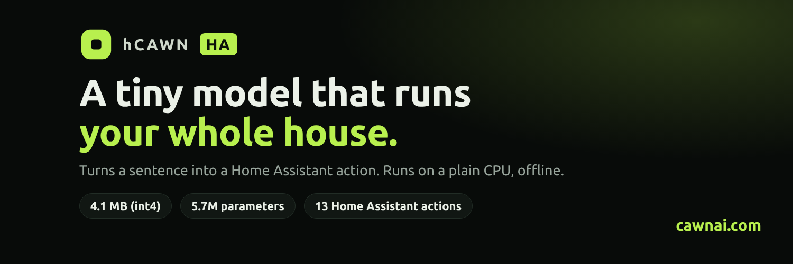
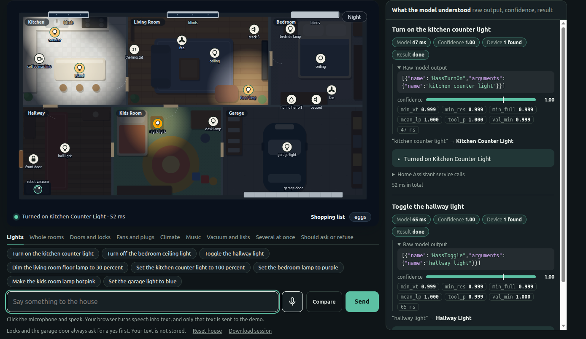

<p align="center"></p>

# hcawn-ha

<p align="center">
  <a href="https://pypi.org/project/hcawn-ha/"></a>
  <a href="https://huggingface.co/spaces/datatab/hcawn-ha-demo"></a>
  <a href="https://huggingface.co/datatab/hcawn-ha"></a>
  <a href="https://cawnai.com"></a>
  <a href="https://github.com/hCAWNfc/hcawn-ha/actions/workflows/test.yml"></a>
</p>

**A 5.7M-parameter model that turns spoken Home Assistant commands into service calls.** 6.0 MB (int8) or 4.1 MB (int4), runs on a CPU, no cloud, no account.

It ships with the pieces around the model: a **resolver** that maps what you said to your devices, a **pipeline** with a confidence gate and safety rules, and a **simulated house** you can talk to in the browser.

```bash
pip install hcawn-ha
hcawn-ha download int8        # weights from huggingface.co/datatab/hcawn-ha (SHA-256 verified)
hcawn-ha demo                 # opens the simulated house in your browser
```



*The demo house. Type or speak a command; the right panel shows the model's raw JSON, its confidence, the device it matched and what happened. Switch int8 / int4, compare them side by side, or add your own devices. Locks and the garage door always ask for a yes first. No install? [Try it in your browser](https://huggingface.co/spaces/datatab/hcawn-ha-demo).*

The engine ships compiled for **Linux x86-64**. On other systems `pip install` gives you the resolver and pipeline only (pass your own `generate` function), and the model runs on the [Hugging Face Space](https://huggingface.co/spaces/datatab/hcawn-ha-demo).

## Use it in Python

```python
from hcawn_ha import HAPipeline

registry = [
    {"entity_id": "light.kitchen_ceiling", "name": "Kitchen Ceiling Light", "area": "Kitchen", "aliases": [], "device_class": None},
    {"entity_id": "lock.front_door", "name": "Front Door", "area": "Hallway", "aliases": [], "device_class": "door"},
]
pipe = HAPipeline("int8", registry, gate=0.7)          # "int8", "int4" or a path to a .bin file

r = pipe.handle("turn off the kitchen light and lock the front door")
r["execute"]   # [{"domain": "light", "service": "turn_off", "data": {"entity_id": ["light.kitchen_ceiling"]}}]
r["confirm"]   # [{"domain": "lock", "service": "lock", ...}]   locks and garage doors wait for a "yes"
r["ask"]       # a question for the user when something was unclear, otherwise ""
```

`execute` is safe to run now, `confirm` needs a spoken or typed yes first, `ask` is shown to the user. Nothing runs when the model is unsure (confidence below `gate`), when the verb contradicts the tool, or when the device is ambiguous.

## How it works

```
"turn off the kitchen light and lock the front door"
   → split into commands
   → model, per command, with confidence      {"name":"HassTurnOff","arguments":{"name":"kitchen light"}}
   → direction guard + validation
   → resolver (your registry: names, rooms, aliases)
   → Home Assistant service calls
```

The model never sees your device list. It copies the device phrase from the request and the resolver finds the entity, so your home can change without retraining. 13 tools: turn on / off / toggle, light brightness and colour, thermostat, humidifier, shopping list, vacuum, media pause / resume / next / previous.

## Results

| | model alone | end to end | official HA intents tests | acon96 V2 test |
|---|---|---|---|---|
| int8 (6.0 MB) | 95.0 % | 92.6 % | 92.4 % right, 0.7 % wrong | 89.7 % right, 1.8 % wrong |
| int4 (4.1 MB) | 94.8 % | 92.6 % | 91.0 % right, 2.1 % wrong | 89.1 % right, 1.4 % wrong |

The acon96 numbers are the independent ones; part of the official-test result was tuned after looking at failures. Details on the [model card](https://huggingface.co/datatab/hcawn-ha).

## Command line

| Command | |
|---|---|
| `hcawn-ha download [int8\|int4\|all]` | fetch weights into `~/.cache/hcawn_ha/` |
| `hcawn-ha say "turn on the bedroom fan"` | one sentence against the demo house, prints the service calls |
| `hcawn-ha chat` | interactive prompt with the model's raw output and confidence |
| `hcawn-ha demo` | the simulated house in your browser (int8 / int4 switch, add your own devices) |
| `hcawn-ha info` | engine variant and available weights |

## License

Code: Apache-2.0. Weights: see the model card. See `NOTICE` for the data the model was trained on.
